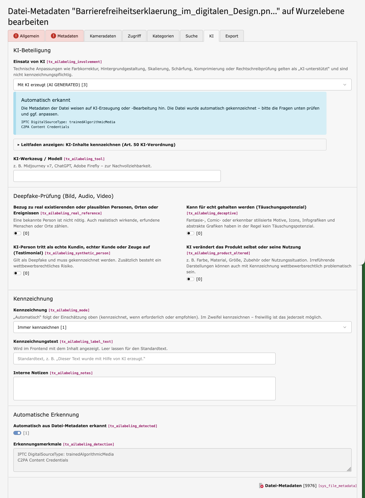

# AI Labeling – EU AI Act Art. 50 for TYPO3

`4viewture/ai-labeling` (extension key `ai_labeling`) adds transparency fields for AI-generated or
AI-modified content to **file metadata** (`sys_file_metadata`), **content elements** (`tt_content`)
and **all other eligible record tables** (pages, news, …), following the guide
[„KI-generierte Inhalte kennzeichnen“](https://digitalzentrum-berlin.de/leitfaden-ki-generierte-inhalte-kennzeichnen)
(Mittelstand-Digital Zentrum Berlin). Transparency obligations apply from 2 August 2026.

Supports **TYPO3 12.4 LTS, 13.4 LTS and 14**, PHP 8.1+.

Editor guide (German): [Documentation/Leitfaden.md](Documentation/Leitfaden.md)

## Example file in file_metadata



## Features

- Own **„KI“ tab** on every type of every eligible table – columns, palettes and tab are added in
  `AfterTcaCompilationEvent` (tables/types of extensions loaded later are covered), database columns
  via `AlterTableDefinitionStatementsEvent` (`sys_file_metadata`/`tt_content` also in `ext_tables.sql`).
- **Eligible tables** (`tables = *`): all tables with types, except `be_*`, `sys_*` (but
  `sys_file_metadata` is always included), `fe_users`, `fe_groups`, cache/index/scheduler/impexp tables,
  `adminOnly`, `readOnly`, `is_static` and root-level (`rootLevel = 1`) tables. Restrict with
  `tables = tt_content,pages,…` or `excludeTables`. Flush caches and run the database compare
  after changing it.
- **Record icon overlay** for all labeled tables (page module, list module, form header, element browser …):
  `ModifyRecordOverlayIconIdentifierEvent` (13+) / `overrideIconOverlay` hook (12). Core status
  overlays (hidden, start/endtime, access, deleted) keep priority. The list module only selects visible
  columns, so `ModifyDatabaseQueryForRecordListingEvent` adds the two needed fields. Rows without the
  fields (e.g. page tree) get no overlay – no extra queries.
- Decision questions from the guide (deepfake criteria, testimonial, product altered,
  public-interest text, human review) with field descriptions.
- **Live assessment** (`<ai-labeling-guide>` web component) on top of the tab: required /
  recommended / optional / none, reasons, resulting label – plus the collapsible guide.
- Label mode: automatic / always / never (warning flash message if a required label is switched off).
- Computed, persisted fields for the frontend: `tx_ailabeling_status`, `tx_ailabeling_active`,
  `tx_ailabeling_reasons` (calculated on save by a DataHandler hook).
- **Automatic detection on upload/replace** (`AfterFileAddedEvent`, `AfterFileReplacedEvent`):
  - IPTC Digital Source Type in XMP/C2PA (`trainedAlgorithmicMedia`, `compositeWithTrainedAlgorithmicMedia`,
    `compositeSynthetic`, `algorithmicallyEnhanced`)
  - C2PA / Content Credentials claim generator
  - PNG text chunks of Stable Diffusion WebUI, ComfyUI, InvokeAI, NovelAI
  - known AI tool names in metadata only (XMP, EXIF, PNG text, ID3, PDF info, MP4 `©too`)
- **File list indicators**
  - Icon overlay via `ModifyIconForResourcePropertiesEvent` (12.4–14): red AI star = labelled,
    outlined star = AI generated/modified but not labelled. Shown wherever the core renders file icons
    (file list, element browser, file references, live search). Core overlays (e.g. missing file) win.
  - Columns *AI labelling status* / *AI label active* selectable in the column selector of the file
    list (metadata fields, readOnly – not part of the edit form).
  - TYPO3 14+: text badge in the name column and `data-ai-labeling*` row attributes via
    `AfterFileListRowPreparedEvent`.
- CLI / scheduler command for existing files: `vendor/bin/typo3 ailabeling:scan [--dry-run] [--storage=1] [--limit=500] [--override-manual]`

## Installation

```bash
composer require 4viewture/ai-labeling
vendor/bin/typo3 extension:setup
```

Fields are `exclude => true` – grant them to editor groups (*Allowed excludefields*).

## Extension configuration

| Setting | Default | Meaning |
|---|---|---|
| `tables` | `*` | Tables with AI fields (`*` or comma list) |
| `excludeTables` | – | Tables to skip |
| `autoDetect` | 1 | Analyse files on upload/replace |
| `autoLabel` | 1 | Set label mode of detected files to "always label" |
| `scanLimitMb` | 32 | Bytes read per file (head + tail half each for larger files) |
| `additionalSignatures` | – | Comma-separated extra tool names |

## Fields

| Field | Type | Notes |
|---|---|---|
| `tx_ailabeling_involvement` | int | 0 none, 1 assisted, 2 modified (AI MODIFIED), 3 generated (AI GENERATED) |
| `tx_ailabeling_tool` | string | tool / model |
| `tx_ailabeling_real_reference`, `_deceptive`, `_synthetic_person`, `_product_altered` | bool | deepfake / product questions |
| `tx_ailabeling_public_interest`, `_human_review`, `_reviewer` | bool/string | text questions |
| `tx_ailabeling_mode` | int | 0 auto, 1 always, 2 never |
| `tx_ailabeling_label_text` | string | empty = default text (`LabelTextResolver`) |
| `tx_ailabeling_detected`, `_detection` | bool/text | automatic detection + evidence |
| `tx_ailabeling_status` | int | computed: 0 none, 1 optional, 2 recommended, 3 required |
| `tx_ailabeling_active` | bool | computed: **render a label in the frontend if 1** |
| `tx_ailabeling_reasons` | csv | computed reason keys |

## Architecture

```
Classes/
  Configuration/TcaFields.php        shared TCA (columns, palettes, tab, SQL)
  Configuration/LabelingTables.php   which tables get the fields
  Detection/AiContentDetector.php    TYPO3-independent metadata analysis
  Service/LabelEvaluator.php         decision logic of the guide (mirrored in label-guide.js)
  Service/AutoLabeler.php            detector -> FAL metadata
  Service/LabelTextResolver.php      label text / defaults (for the upcoming frontend part)
  EventListener/                     TCA/SQL for all tables, detection, icon overlays, list module select
  Service/RecordOverlay.php          overlay decision for record icons
  Hooks/DataHandlerHook.php          persist computed status on save
  Form/Element/GuideInformation.php  FormEngine fieldWizard: guide + live assessment
  Command/ScanCommand.php            ailabeling:scan
```

Compatibility notes: no PHP attributes for listeners/commands (v12), no Fluid `StandaloneView`
(removed in v14), FormEngine node without own constructor (v12 constructor / v13+ `setData()`),
file types as integers instead of `AbstractFile::FILETYPE_*`.

## Limitations

- Detection is heuristic. Metadata is often stripped by editing tools or social networks;
  invisible watermarks (e.g. SynthID) cannot be read. A tool name inside a human-written caption
  can cause a false positive – the editor reviews the result in the AI tab.
- Detection writes the default-language metadata record only.
- Tiles view with thumbnails: the thumbnail replaces the icon, so the overlay is only visible for
  files without preview; the core offers no event for tiles (12–14).
- Record overlay only when the core shows no status overlay (hidden etc. win) and only where the
  rendered row contains the AI fields (not in the page tree).
- Frontend output is not part of this version.

## Tests

```bash
vendor/bin/phpunit Tests/Unit
```

The unit tests cover the decision logic and the detector (synthetic JPEG/XMP, PNG chunks, C2PA/CBOR, large files).
